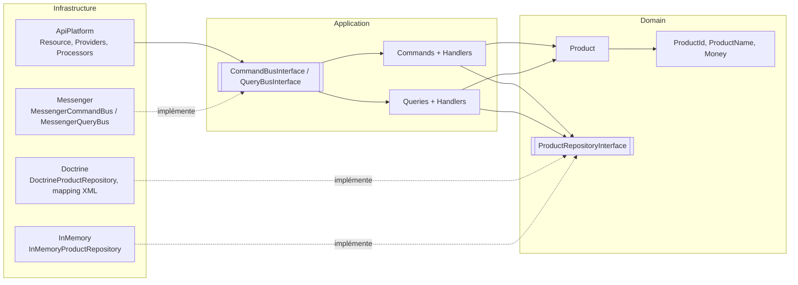

# 01 — Architecture hexagonale

## Principe

Le code est découpé en **bounded contexts** (`src/Catalog`, et un noyau partagé `src/Shared`). Chaque contexte est organisé en trois couches concentriques :

| Couche | Rôle | Dépend de |
|---|---|---|
| `Domain` | Modèle métier, invariants, value objects, **ports** (interfaces de repository) | rien (PHP pur) |
| `Application` | Cas d'usage : commandes, requêtes et leurs handlers | `Domain` |
| `Infrastructure` | **Adapters** : Doctrine, API Platform, Messenger, InMemory | `Application`, `Domain`, frameworks |

La règle de dépendance est stricte : **les flèches pointent toujours vers le domaine**. Aucun `use Symfony\…`, `Doctrine\…` ou `ApiPlatform\…` n'apparaît dans `Domain` ni dans `Application`.



## Arborescence

```
src/
├── Shared/
│   ├── Domain/            Pagination, DomainException, NotFoundException
│   ├── Application/       CommandInterface, CommandBusInterface, CommandHandlerInterface
│   │                      QueryInterface, QueryBusInterface, QueryHandlerInterface
│   └── Infrastructure/    Messenger/ (adapters des bus)
└── Catalog/
    ├── Domain/            Model/Product, ValueObject/*, Repository/ProductRepositoryInterface, Exception/ProductNotFound
    ├── Application/       Command/{Create,Update,Delete}Product, Query/{FindProduct,FindProducts}
    └── Infrastructure/    Doctrine/, InMemory/, ApiPlatform/
```

## Ports et adapters

| Port (interface) | Adapter(s) | Câblage |
|---|---|---|
| `Catalog\Domain\Repository\ProductRepositoryInterface` | `DoctrineProductRepository` (runtime), `InMemoryProductRepository` (tests unitaires) | alias dans `config/services.yaml` |
| `Shared\Application\Command\CommandBusInterface` | `MessengerCommandBus` | autowiring |
| `Shared\Application\Query\QueryBusInterface` | `MessengerQueryBus` | autowiring |

Côté entrée (*driving side*), l'adapter est API Platform : il traduit HTTP en commandes/requêtes. Côté sortie (*driven side*), Doctrine implémente le port de persistance.

## Modèle de domaine

- `Product` : agrégat. Construction uniquement via `Product::create()`, modification via `update()`. Les dates (`createdAt`, `updatedAt`) sont gérées par l'agrégat, l'horloge est injectable pour les tests.
- `ProductId` : UUID v7 généré en PHP pur (ordonné dans le temps, compatible index B-tree).
- `ProductName` : chaîne non vide, 255 caractères max, trimée.
- `Money` : montant entier en **unités mineures** (centimes) ≥ 0 + devise ISO 4217 (3 lettres, majuscules).

Toute violation d'invariant lève `Shared\Domain\Exception\DomainException`, mappée en HTTP 422.

## Pourquoi un DTO API séparé de l'entité

`ProductResource` (Infrastructure) est la représentation HTTP ; `Product` (Domain) est le modèle métier. Cette séparation permet :
- de garder le domaine sans attributs framework ;
- de faire évoluer le contrat d'API indépendamment du modèle ;
- d'appliquer la validation de surface (Symfony Validator) avant d'atteindre le domaine, qui reste le garant final des invariants.
