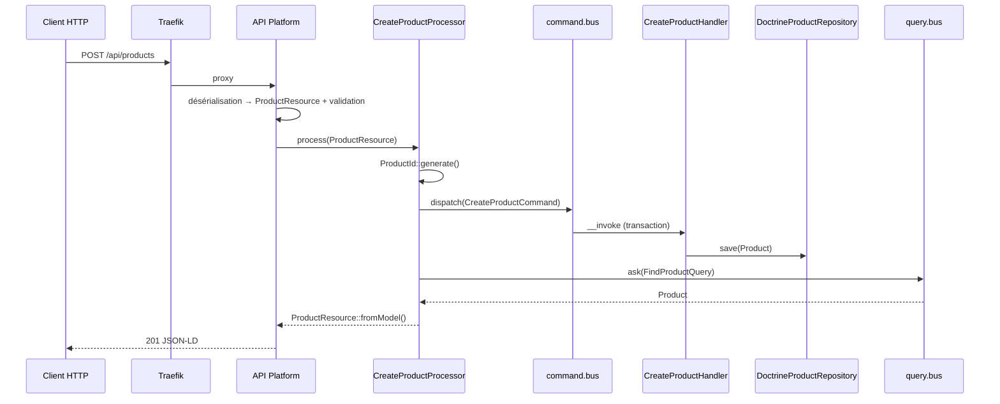
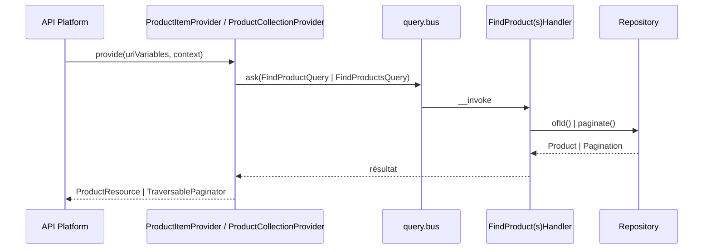

# 02 — CQRS

## Deux bus distincts

Définis dans `config/packages/messenger.yaml` :

| Bus | Service | Messages | Retour |
|---|---|---|---|
| Commandes | `command.bus` | `CommandInterface` | rien (`void`) |
| Requêtes | `query.bus` | `QueryInterface` | le résultat du handler |

Les deux bus sont **synchrones** (aucun transport). Le `command.bus` est équipé du middleware `doctrine_transaction` : chaque commande s'exécute dans une transaction.

Les handlers n'utilisent **pas** l'attribut `#[AsMessageHandler]` (qui couplerait la couche Application à Symfony). Ils implémentent une interface marqueur et sont auto-tagués dans `config/services.yaml` :

```yaml
_instanceof:
    App\Shared\Application\Command\CommandHandlerInterface:
        tags: [{ name: messenger.message_handler, bus: command.bus }]
    App\Shared\Application\Query\QueryHandlerInterface:
        tags: [{ name: messenger.message_handler, bus: query.bus }]
```

Messenger déduit le message traité à partir du type du premier argument de `__invoke()`.

Les adapters `MessengerCommandBus` / `MessengerQueryBus` déballent `HandlerFailedException` pour relancer l'exception métier d'origine (`ProductNotFound`, `DomainException`), afin qu'API Platform puisse la convertir en code HTTP.

## Cas d'usage du contexte Catalog

| Type | Message | Handler |
|---|---|---|
| Command | `CreateProductCommand(id, name, description, price, currency)` | `CreateProductHandler` |
| Command | `UpdateProductCommand(id, name, description, price, currency)` | `UpdateProductHandler` |
| Command | `DeleteProductCommand(id)` | `DeleteProductHandler` |
| Query | `FindProductQuery(id)` → `Product` | `FindProductHandler` |
| Query | `FindProductsQuery(page, itemsPerPage)` → `Pagination<Product>` | `FindProductsHandler` |

L'identifiant est généré **avant** l'envoi de la commande (dans le processor), ce qui permet à la commande de rester sans valeur de retour tout en connaissant l'id à relire ensuite.

## Cycle d'une écriture (POST)



## Cycle d'une lecture (GET)



`PUT`, `PATCH` et `DELETE` passent d'abord par `ProductItemProvider` (404 si absent), puis par leur processor.

## Ajouter un cas d'usage

1. Créer `src/<Context>/Application/Command/<Action>/<Action>Command.php` implémentant `CommandInterface` (propriétés `public readonly`, types scalaires).
2. Créer `<Action>Handler.php` implémentant `CommandHandlerInterface`, avec `__invoke(<Action>Command $command): void`.
3. Injecter le port de repository nécessaire dans le constructeur.
4. Depuis l'adapter d'entrée, appeler `CommandBusInterface::dispatch()`.

Même démarche pour une requête (`QueryInterface`, `QueryHandlerInterface`, `QueryBusInterface::ask()`), le handler retournant une valeur.

Vérifier l'enregistrement : `make console c="debug:messenger"`.
