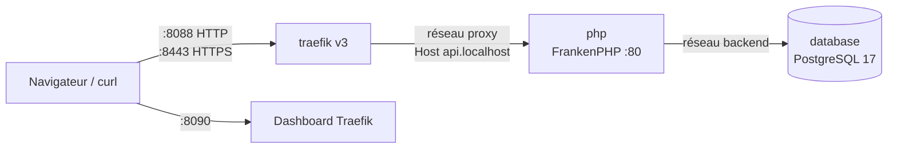

# 05 — Docker et Traefik

## Services (`compose.yaml`)

| Service | Image | Ports hôte | Réseaux |
|---|---|---|---|
| `traefik` | `traefik:v3` | `8088→80`, `8443→443`, `8090→8080` | `proxy` |
| `php` | build `docker/php/Dockerfile` (cible `dev`) | aucun | `proxy`, `backend` |
| `database` | `postgres:17-alpine` | aucun | `backend` |

Les ports 80/443/5432/8080/8081 de la machine étant déjà utilisés, le projet utilise des ports dédiés et n'expose pas PostgreSQL. La base n'est joignable que depuis le réseau `backend`.

## Traefik

Configuration statique par arguments de ligne de commande :
- provider Docker, `exposedbydefault=false` : seuls les conteneurs avec `traefik.enable=true` sont routés ;
- `providers.docker.network=symfony-hexa-cqrs_proxy` : Traefik joint le conteneur via le réseau `proxy` ;
- entrypoints `web` (:80) et `websecure` (:443) ;
- dashboard en mode `insecure` sur :8080 (développement uniquement).

Configuration dynamique par labels sur le service `php` :

| Label | Valeur |
|---|---|
| `traefik.http.routers.api.rule` | ``Host(`api.localhost`)`` |
| `traefik.http.routers.api.entrypoints` | `web` |
| `traefik.http.routers.api-secure.entrypoints` | `websecure` |
| `traefik.http.routers.api-secure.tls` | `true` (certificat auto-signé par défaut de Traefik) |
| `traefik.http.services.api.loadbalancer.server.port` | `80` |

Le nom d'hôte est paramétrable par la variable `APP_HOST`. Les sous-domaines `*.localhost` résolvent nativement vers `127.0.0.1` dans les navigateurs et dans `curl`.

En HTTPS, le certificat est auto-signé : utiliser `curl -k` ou accepter l'exception dans le navigateur. Pour un certificat de confiance, monter des certificats `mkcert` et déclarer un `tls.stores.default` dans une configuration dynamique fichier.

## Image PHP

`docker/php/Dockerfile`, multi-stage :

| Cible | Contenu |
|---|---|
| `base` | FrankenPHP (PHP 8.4), extensions `apcu intl opcache zip pdo_pgsql`, Composer, utilisateur `app` (UID/GID de l'hôte, 1000 par défaut) |
| `dev` | `php.ini-development`, mode `--watch`, code monté en volume |
| `prod` | `php.ini-production`, `composer install --no-dev`, autoload optimisé, code copié dans l'image |

Le conteneur tourne en utilisateur non-root ; la capacité `CAP_NET_BIND_SERVICE` permet à FrankenPHP d'écouter sur le port 80. Les fichiers créés dans le volume appartiennent donc à l'utilisateur de l'hôte.

`docker/php/Caddyfile` : HTTPS automatique désactivé (TLS terminé par Traefik), racine `public/`, `php_server`.

## Variables d'environnement

| Variable | Défaut | Usage |
|---|---|---|
| `APP_HOST` | `api.localhost` | règle `Host` Traefik |
| `POSTGRES_DB` / `POSTGRES_USER` / `POSTGRES_PASSWORD` | `app` / `app` / `app` | base et `DATABASE_URL` |
| `USER_ID` / `GROUP_ID` | `1000` | utilisateur du conteneur `php` |

## Makefile

| Commande | Effet |
|---|---|
| `make setup` | build + up + `composer install` + migrations + fixtures |
| `make up` / `make down` | démarrer / arrêter |
| `make logs` | logs de tous les services |
| `make sh` | shell dans `php` |
| `make composer c="…"` | commande Composer |
| `make console c="…"` | commande `bin/console` |
| `make migrate` | migrations Doctrine |
| `make fixtures` | purge et charge les données de démonstration |
| `make test` | prépare `app_test` et lance PHPUnit |
