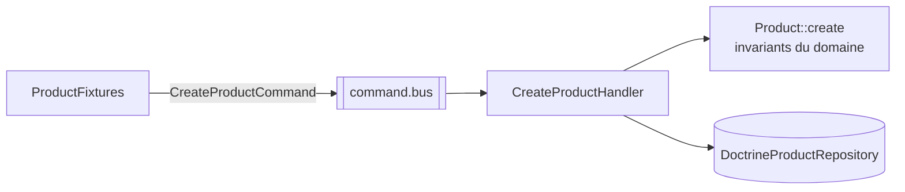

# 08 — Fixtures

```bash
make fixtures
```

Purge la table `product` puis charge **50 produits** générés avec Faker (locale `fr_FR`). `make setup` les charge automatiquement.

## Principe : passer par le cas d'usage

`fixtures/Catalog/ProductFixtures.php` ne persiste pas d'entités directement avec l'`ObjectManager` : chaque produit est créé en envoyant une `CreateProductCommand` sur le `command.bus`.



Conséquences :
- les données de démonstration respectent les mêmes invariants que l'API (nom, montant ≥ 0, devise ISO) ;
- aucune logique de construction n'est dupliquée ;
- une évolution du domaine casse les fixtures au même titre que le reste, ce que le test `ProductFixturesTest` détecte.

## Données générées

| Champ | Génération |
|---|---|
| `name` | `<article> <qualificatif> <référence>`, ex. `Clavier compact BH-960` |
| `description` | 80 % des produits : slogan + garantie + fabricant ; sinon `null` |
| `price` | entier entre 499 et 49 999 centimes |
| `currency` | `EUR` majoritaire, `USD`, `GBP` |

Le générateur Faker est initialisé avec une graine fixe (`SEED`) : les noms, prix et descriptions sont identiques d'un chargement à l'autre. Les identifiants (UUID v7) et les dates changent à chaque chargement.

## Emplacement et environnements

Les fixtures sont dans `fixtures/` (namespace `App\Fixtures\`), **hors de `src/`** :

| Élément | Configuration |
|---|---|
| Dépendances | `doctrine/doctrine-fixtures-bundle`, `fakerphp/faker` en `require-dev` |
| Bundle | activé en `dev` et `test` uniquement (`config/bundles.php`) |
| Autoload | `autoload-dev` → `"App\\Fixtures\\": "fixtures/"` |
| Services | `when@dev` / `when@test` dans `config/services.yaml` |

`src/` est entièrement enregistré comme services dans tous les environnements. Une fixture placée dans `src/` ferait échouer la compilation du conteneur en `prod`, où l'image est construite avec `composer install --no-dev` et où la classe `Doctrine\Bundle\FixturesBundle\Fixture` n'existe pas.

## Ajouter une fixture

1. Créer `fixtures/<Contexte>/<Ressource>Fixtures.php` étendant `Doctrine\Bundle\FixturesBundle\Fixture`.
2. Injecter `CommandBusInterface` et envoyer les commandes du contexte.
3. Pour ordonner plusieurs fixtures, implémenter `DependentFixtureInterface`.
4. Charger un seul groupe : implémenter `FixtureGroupInterface` puis `make console c="doctrine:fixtures:load --group=<groupe> -n"`.
